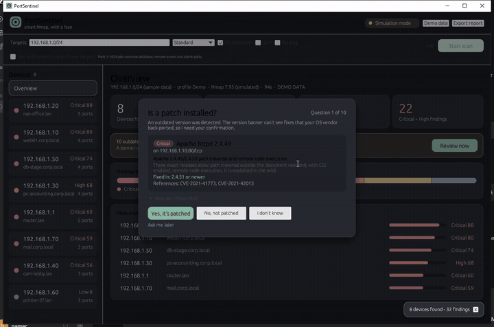

# NET Discovery

*Smart Nmap, with a face — for Windows.*


<div align="center">
  

## About

**NET Discovery** turns raw Nmap output into a clear picture of network
exposure: which devices answer on dangerous ports, which services run
outdated or end-of-life versions, and what to do about each finding.

The app walks the operator through every verdict: banner versions cannot
reveal vendor back-ports, so NET Discovery asks *“Is a patch installed?”*
for each outdated service and keeps unanswered items marked unverified.
The result is a report you can actually trust — and act on.

> Findings come from a built-in rule set (risky ports, known-vulnerable
> and end-of-life versions) and are heuristics: version banners can be
> hidden, spoofed or back-patched. Treat the report as a starting point
> for verification, not as proof of compromise. Only scan networks you
> are authorised to test.

## Features

- **Host overview with risk scores** — every device gets a severity badge
  (Critical / High / Low) plus open-port counts at a glance.
- **Findings that explain themselves** — each rule hit shows the service,
  the affected version, why it is dangerous, the fixed version and CVE
  references (Apache path traversal, SambaCry, OpenSSH "regreSSHion" and
  user enumeration, Exim RCE, ProFTPD mod_copy, EOL databases, telnet and
  more).
- **Patch review** — an interactive questionnaire (Yes, it's patched /
  No, not patched / I don't know / Ask me later) reconciles banner
  versions with what the operator knows, so the report stays accurate.
- **Reports** — one click exports a self-contained **Network Exposure
  Report** (HTML, plus CSV/JSON) with a summary, devices-by-risk table and
  the patch answers.
- **Bundled sample network** — a full 192.168.1.0/24 dataset ships inside
  the app, so the whole workflow can be explored without a live scan.

## Screenshots

| Scan results & patch review |
|---|
|  |

## Getting Started

No installation — download the folder and run:

```bat
NET Discovery.exe
```

1. Type the target range on the welcome screen and press **Start scan**
   (or pick the bundled sample network to explore right away).
2. Watch the scan sweep the address space and grade every discovered
   host.
3. Answer the patch questions as they come up — *Yes / No / I don't
   know / Ask me later*.
4. Browse hosts in the sidebar, open findings, then press
   **Export report** to save the HTML report.

## Development

Single-binary desktop app written in **Rust** with **egui/winit**. Scan
results arrive as Nmap XML and go through the same parser a live scan
would use; the bundled sample network is an embedded Nmap-XML dataset
(`nmap -sV -O 192.168.1.0/24`).

## Notes and Caveats

¹ *Heuristics* — version-based rules cannot see vendor back-ports; that is
exactly what the interactive patch review compensates for.

## License

[MIT](https://opensource.org/licenses/MIT)
